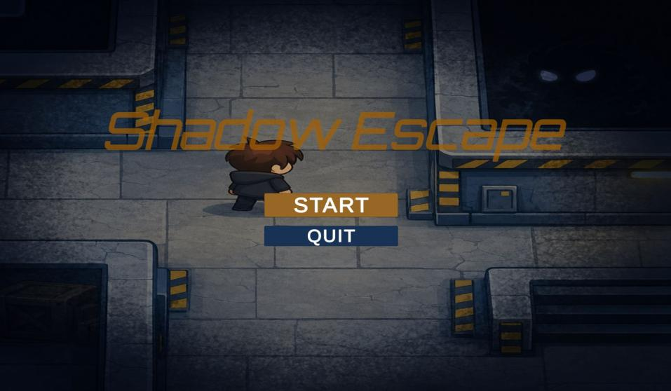
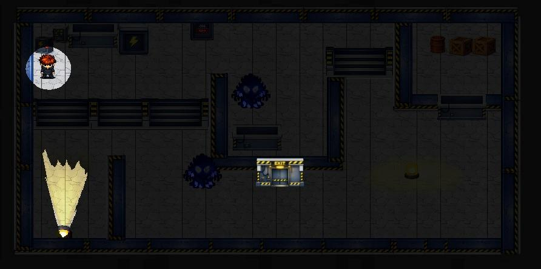
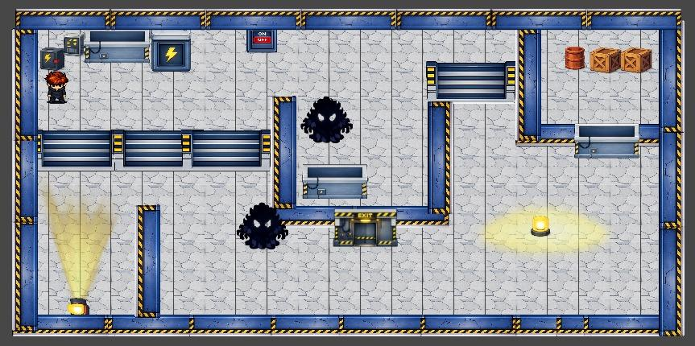
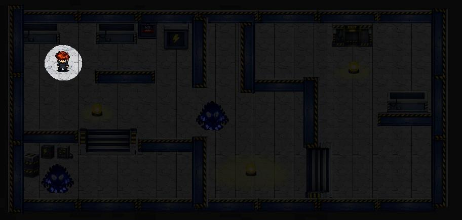
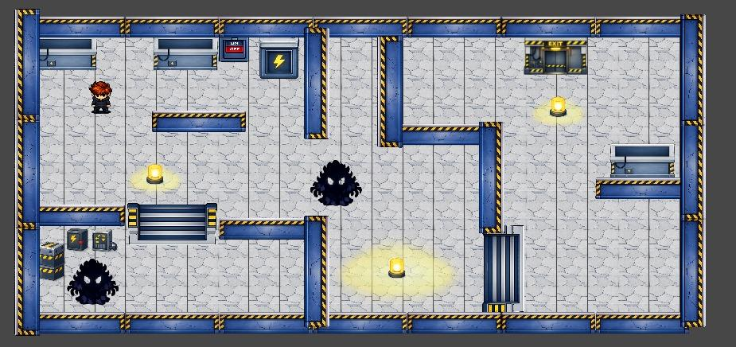
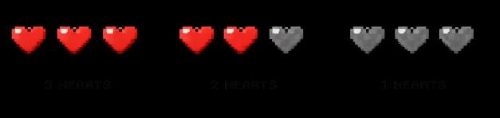
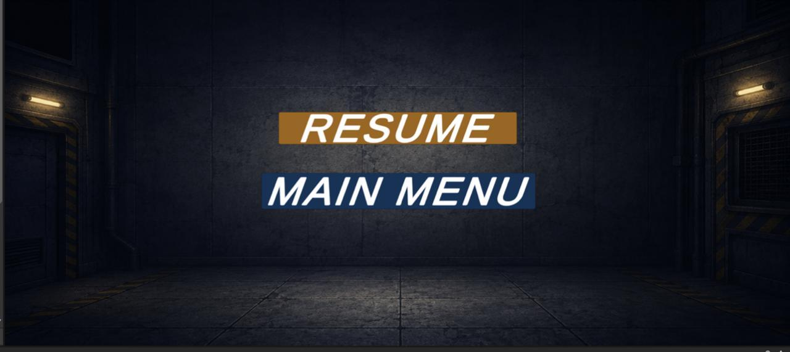
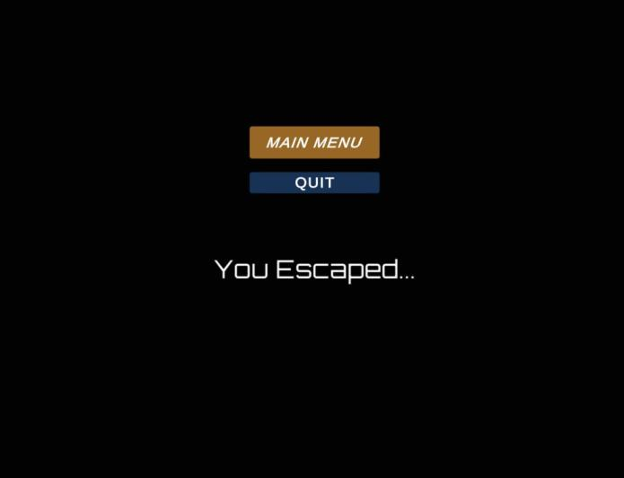
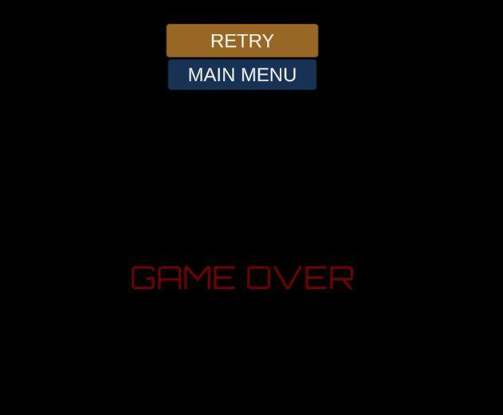

# Shadow Escape — 2D Survival Game

**Unity · C# · Game Development · Survival Mechanics**

A single-player 2D survival adventure set in a dark industrial facility. Use light strategically to create safe zones, avoid a shadow creature, and reach the exit before time runs out.

## Game gallery

*Original screenshots from the Shadow Escape game design document.*

### Main menu

<p align="center"></p>

### Level design — light versus darkness

| Level 1 — Dark | Level 1 — Illuminated |
| --- | --- |
|  |  |

| Level 2 — Dark | Level 2 — Illuminated |
| --- | --- |
|  |  |

### Game interface

| Health | Timer | Pause |
| --- | --- | --- |
|  |  |  |

### Game outcomes

| Victory | Game over |
| --- | --- |
|  |  |

## Gameplay

- **Navigate:** Move through industrial corridors with WASD or arrow keys.
- **Control the environment:** Activate switches to illuminate safe areas.
- **Survive:** Avoid the creature in darkness while managing three hearts.
- **Beat the clock:** Reach the exit before the countdown expires.
- **Explore:** Two industrial level designs are documented in the game design summary.

## Engineering highlights

| System | Purpose |
| --- | --- |
| Player controller | Movement and animation |
| Light and switch interactions | Player-triggered safe zones |
| Enemy logic | Shadow-creature pursuit and collisions |
| Timer and health | Survival constraints |
| Menus and end states | Pause, win, and loss flows |

## Run in Unity

1. Install **Unity 2019.4.29f1** (version recorded in the original project).
2. Open this repository as a Unity project using Unity Hub.
3. Let Unity import assets and resolve package dependencies.
4. Open a scene under `Assets/Scenes/` and press **Play**.

**Source status:** The Unity project directories `Assets/`, `Packages/`, and `ProjectSettings/` have been uploaded. The game has not been independently built or play-tested.

## Repository layout

```text
Assets/           Scenes, C# scripts, animations and art
Packages/         Unity package configuration
ProjectSettings/  Unity project settings
```

## Documentation

See the [public-safe game design summary](Shadow_Escape_GDD_Public_Summary.md).

## Credits and responsible sharing

This is a **collaborative game development project**. Third-party artwork and audio may have separate licensing requirements. Music and sound files with unverified redistribution rights are excluded from the prepared public copy; replace them with appropriately licensed audio before distributing a playable build.

---

*Survive the darkness. Find the light. Escape.*
